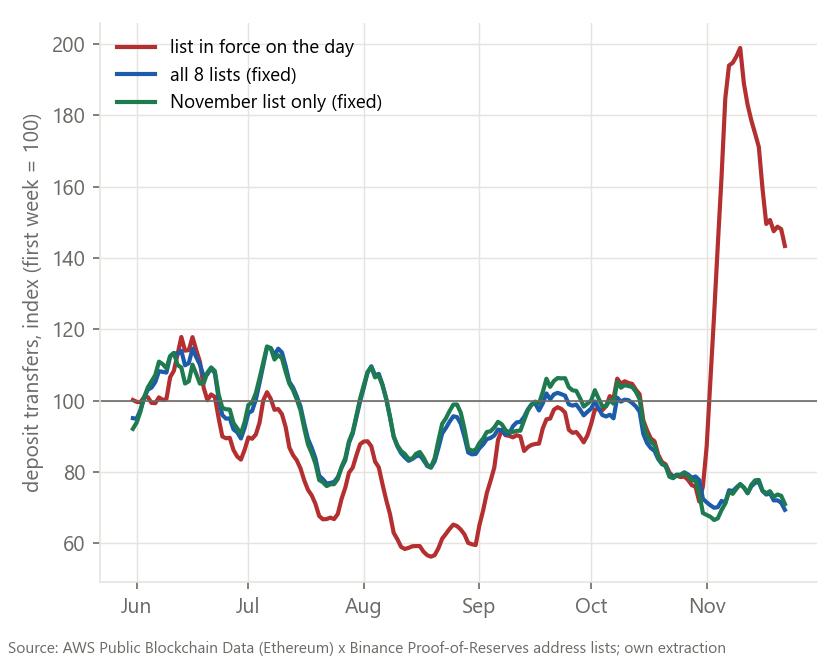

# Campaign, crowd, cycle or counting? Growth-campaign analytics for Binance

Independent case study for the **Data Analyst (12 months contract)** role at Binance (Central Data Analytics).
When a growth number moves, four causes have to be separated before recommending anything: the **campaign**
(incremental effect), the **crowd** (who was acquired), the **cycle** (the market) and the **counting** (the
measurement). The study does it on **real public data about Binance** and on a **simulated exchange** with planted,
known effects.

**Links:** [PDF report (10 pages)](report/Binance_growth_campaign_analytics.pdf) ·
[dashboard (6 tabs)](dashboard/index.html) · [campaign readouts](reports/readouts/) ·
[weekly review](reports/weekly/) · [ROI workbook](excel/campaign_roi_workbook.xlsx) · [SQL](sql/README.md) ·
[playbooks](docs/playbooks/) · [metrics dictionary](METRICS.md) · [executive memo](docs/executive_memo.md)



## Key results
1. **Counting (PUBLIC DATA).** Over 182 days of Ethereum flows to and from the addresses Binance published in its
   Proof of Reserves, deposit transfers changed **+43%** (last 4 weeks vs first 4) when
   counted with the list in force each day, but **-31%** on a fixed list: the published list
   grew from 1,818,261 to 8,139,203 deposit addresses, and only
   32.7% of the addresses sending tokens to Binance wallets on 20 Nov are in it
   (6,468 of 19,770).
2. **Calendar (PUBLIC DATA).** 750 real "Latest Activities" announcements; about
   37 promotions live on an average day. Of 19 USDT/USDC deposit or Earn
   campaigns tested against 1,000 placebo dates, 0 stand(s) out after Benjamini-Hochberg; the
   smallest detectable change is 11% on active USDT deposit addresses, so single campaigns are
   mostly invisible in public data.
3. **Crowd (SIMULATED).** The campaign with the lowest CAC of the quarter (9.00 USD per first depositor) has a
   30-day ROI of **-58%**: 55% of its depositors withdrew at least 90% within
   30 days (bonus hunters).
4. **Cycle (SIMULATED).** A trading competition launched on the real most volatile BTC day of the window shows
   **+46%** trades naive, but **+5.3%** against untreated regions (95% CI
   +1.6% to +9.2%). Across all campaigns, naive before/after misses the planted
   effect by 85 points on average, difference-in-differences by
   7, the randomised holdout by 0.1.

## What a growth data analyst delivers here
| Mission in the job post | Deliverable |
|---|---|
| Support growth and marketing campaigns end to end: extract, validate and structure funnel data | `sql/` (28 query files, 13 tests, 4 detectors), launch QA checklist, dedup and time-zone rules |
| Measure conversion, CAC, ROI, retention of acquired users; actionable recommendations | campaign scorecard, cohorts, Kaplan-Meier, incrementality (holdout, DiD, synthetic control), readouts |
| Build and maintain campaign and growth dashboards; automate recurring extracts | `dashboard/index.html`, `powerbi/`, `bi/datawind_mapping.md`, `pipelines/daily_refresh.py` |
| Large behavioural and transaction data in SQL; cohort analyses | 182 days of Ethereum (about 2.1 M transactions and 3.7 M token transfers per day read), 24.7 M simulated rows |
| Simple visuals and clear stories for operations and leadership | 10-page PDF, one-page readouts, weekly review, executive memo |
| Fast time to market | `tools/growth_cli.py`, readout generator, daily refresh (15 min end to end) |

## Methods
- **Real data**: Binance Proof-of-Reserves address files (8 snapshots), AWS Public Blockchain Data (Ethereum, read
  anonymously, only the needed columns), official Binance market data (checksums verified), Binance announcements.
  Three list definitions are compared; failed, zero-value and internal transfers are measured and excluded; address
  cohorts use an 8-week burn-in. The 15 reference figures of 20 Nov 2026 are reproduced exactly (SQL test).
- **Simulated exchange**: 13 weeks, 1,365,325 sign-ups, 40 campaigns, 8 hidden events, anchored on real
  market data, the real hourly deposit profile and the real campaign mix (`docs/assumptions.md`). The events are found
  without reading the truth, then checked against it.
- **Statistics** (`src/stats.py`, `docs/statistics_notes.md`): difference-in-differences with clustered errors,
  synthetic control, placebo tests, holdout with SRM and CUPED, Kaplan-Meier, Markov attribution with bootstrap,
  Benjamini-Hochberg, direct standardisation, control charts and CUSUM with a 13-week backtest.
- Every number in the report and this README is read from `data/processed/findings.json`.

> AI-assisted workflow: I used Claude, mainly to write scripts faster. I drove the project: I defined the questions, chose and validated the data sources, made the analytical decisions and checked every result.

## How to re-run
```
python -m venv .venv
.venv\Scripts\activate
pip install -r requirements.txt
python src/fetch_public.py all            # uses the cache in data/raw if present
python src/extract_onchain.py --start 2026-05-25 --end 2026-11-22
python src/campaigns_calendar.py
python src/run_sql.py --part public       # on-chain layer (also builds the hourly profile)
python src/simulate_exchange.py
python src/run_sql.py                      # every query + SQL tests
pytest
python src/findings.py
python src/crosscheck.py                  # second method (pandas) for 11 report figures
python src/charts.py
python src/build_dashboard.py
python tools/campaign_readout.py --campaign CMP014
jupyter nbconvert --to notebook --execute --inplace notebooks/binance_growth_campaign_analytics.ipynb
python src/build_pdf.py
```
`python src/run_all.py` runs the offline steps in order. The extraction reads about 138 GB from
AWS (column pruning) and took about 5.0 hours of process time.

## Sources and conditions
See [data/README.md](data/README.md). No raw data is redistributed; only aggregates (at least 20 addresses per cell)
and a 10,000-row simulated sample are published. No blockchain address, no announcement title and no personal data
appear in this repository.

## Limits
Ethereum only (not Tron, BNB Chain, Solana or Bitcoin); the published list changes every month and covers part of
the active deposit addresses; an address is not a user and a new address is not a new customer; market relations are
associations; the simulated exchange is fictional and says nothing about Binance's users, revenue, CAC, channels or
campaign results. Rules on crypto promotions differ by jurisdiction.

**Not investment advice.**

Independent case study based on public data · not affiliated with or endorsed by Binance · Not investment advice
